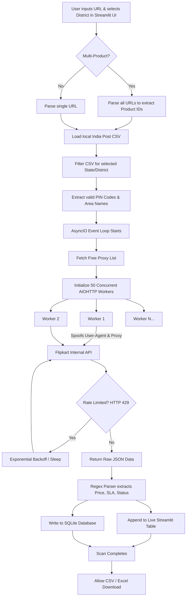

# Technical Explanation & Architecture

This document provides a comprehensive, ground-up explanation of the logic, methodologies, and technologies used to build the Flipkart Availability Tracker.

---

## 1. The Genesis of the Idea
### The Problem
When shopping on Flipkart for high-demand or clearance items (e.g., the CMF by Nothing Phone), users often see a banner stating "Only 3 left in stock." However, upon entering their local PIN code, the product shows as "Out of Stock." 
This happens because e-commerce logistics rely on distributed warehouses. The remaining stock is reserved for specific geographic zones. Manually guessing which PIN code has the stock is practically impossible since India has over 19,000 PIN codes.

### The Solution
Build an automated tool that systematically queries the Flipkart backend with every valid PIN code in a specific region, logs the results, and outputs a clean list of hyper-local areas where the product is genuinely deliverable.

---

## 2. Evolution of the Project
The project evolved rapidly from a basic script to a full application:

1. **Phase 1 (The Basic Script):** A single-threaded Python script that sent basic HTTP requests. It was incredibly slow (taking ~40 minutes for one state) and lacked a user interface.
2. **Phase 2 (The UI Upgrade):** We integrated **Streamlit** to provide a visual interface, allowing users to paste URLs and select target states without touching code.
3. **Phase 3 (The Speed & Data Upgrade):** 
   - Switched from basic threads to **AsyncIO** for massive concurrency.
   - Merged the results with the official India Post dataset to show exact **Area/Neighborhood names** instead of just raw numbers.
   - Implemented **District-level filtering** to narrow down targets and speed up scans to mere seconds.
4. **Phase 4 (v1.0 ULTIMATE):** Added **IP Rotation** to prevent bans, **Multi-Product scanning** matrices, and a **SQLite Database** to track historical analytics and price changes over time.

---

## 3. Technologies & Tools Used

* **Python 3.12:** The core programming language.
* **Streamlit:** Used to instantly compile the Python backend logic into a reactive, modern Web Application UI (complete with custom Flipkart-branded CSS theming).
* **AsyncIO & AIOHTTP:** Replaces synchronous `requests`. It allows the application to fire 50+ network requests simultaneously without waiting for the previous ones to complete.
* **Pandas:** Used for heavy data manipulation—specifically reading the massive `india_post_pincodes.csv`, dropping duplicates, and merging the final JSON API results with the geographic data.
* **SQLite3:** A lightweight database engine used to permanently log every scan, powering the "Analytics & History" tab.
* **OpenPyXL:** Enables exporting the final pandas DataFrames into beautifully formatted `.xlsx` Excel spreadsheets.
* **Regular Expressions (Regex):** Used to rapidly parse through Flipkart's massive, messy raw JSON responses to instantly find `serviceable` flags, pricing, and estimated delivery dates.

---

## 4. Architecture & Workflow

Below is a visual representation of how the application processes a user request from start to finish.

---

## 5. Detailed Methodology

### The API Spoofing Method
Web browsers use heavy automation tools (like Selenium) that take seconds to load a single page. We bypassed this by observing the network traffic of a real browser. When you type a PIN code on Flipkart, the browser sends a hidden `POST` request to `https://1.rome.api.flipkart.com/api/4/page/fetch`. 
Our Python script mimics this exact request. By copying the `locationContext` payload and spoofing the `User-Agent` headers, Flipkart's servers treat our Python script exactly like a normal Google Chrome user.

### IP Rotation & Anti-Ban
E-commerce sites employ rate-limiting. If one IP address checks 5,000 PIN codes in a minute, it gets temporarily banned. 
To bypass this, the app dynamically scrapes a GitHub repository for fresh, free HTTP proxies. During the Async loop, every worker randomly selects a different proxy for its specific request. To Flipkart, the scan looks like 5,000 different people from around the world checking the website once, rather than one person checking it 5,000 times.

### Data Enrichment
A raw result saying "560095 is available" is hard for a human to contextualize. The app uses `pandas.merge()` to map the API response against the India Post dataset, successfully turning raw server data into: *"CMF Phone is available in Koramangala VI Bk (Bangalore Urban) for ₹18,999 with Delivery by Tomorrow."*
